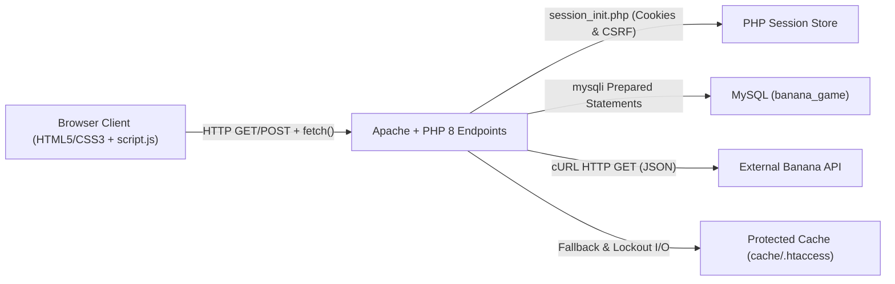
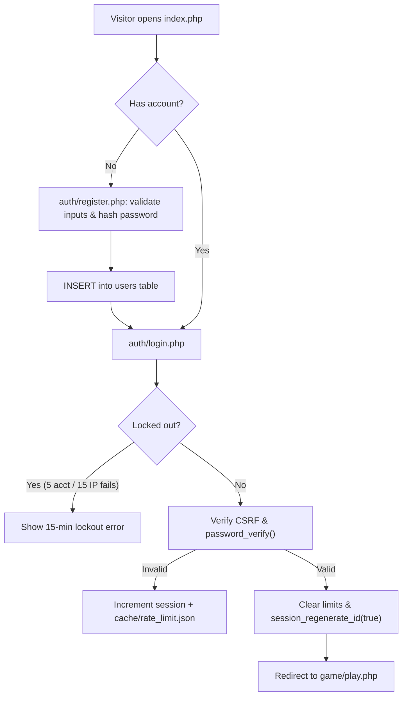
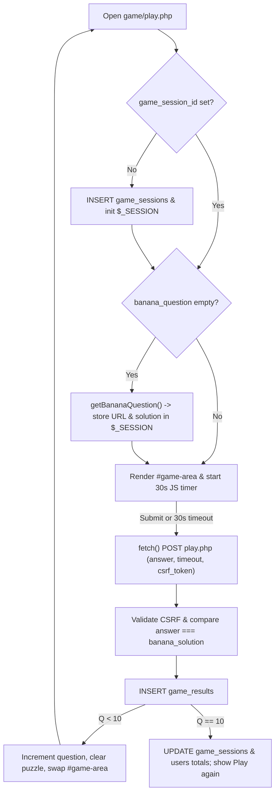
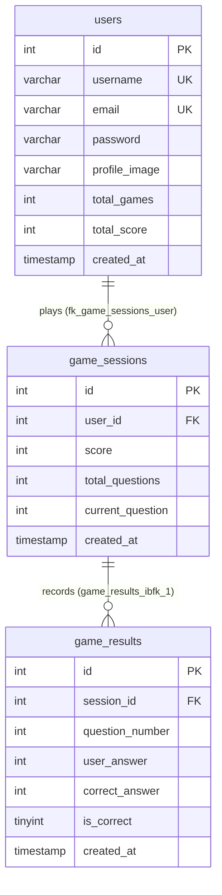
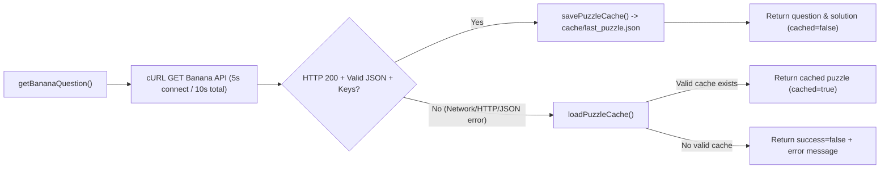
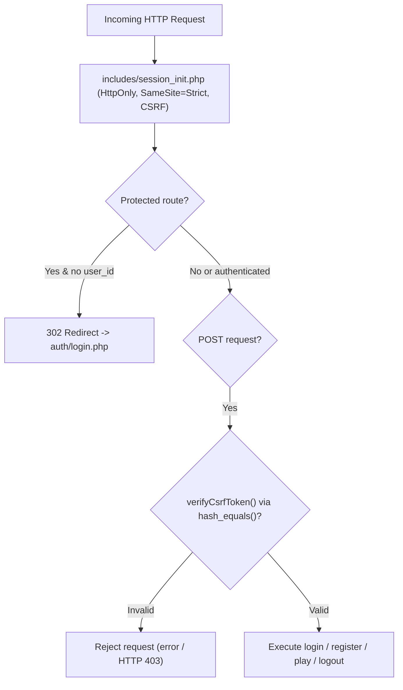

# Banana Game — Software Engineering Documentation (v3.0)

> **Documentation Release Notice (v3.0):** Version `3.0` is a **documentation-only and project presentation milestone**. It expands the architectural, database, security, testing, and academic documentation for the completed application without modifying any PHP, JavaScript, CSS, or SQL source code from the `v1.0` functional release (`c5f7251`).

---

## 1. Project Overview and Objectives

The **Banana Game** is a full-stack PHP 8 and MySQL interactive math-puzzle web application hosted on XAMPP (Apache + MariaDB/MySQL). Registered players solve 10-question puzzle rounds fetched dynamically from an external web service (**Marc Conrad's Banana API**), compete on a global leaderboard, and track their cumulative scores.

### Core Objectives
- **Modular Web Architecture:** Separate authentication, gameplay, configuration, shared security/API helpers, and frontend assets into clear domain directories.
- **Event-Driven User Experience:** Eliminate full-page flicker during gameplay using asynchronous `fetch()` requests, partial DOM updates, a 30-second countdown timer, and numeric keyboard shortcuts.
- **Cross-System Interoperability:** Consume a third-party REST/JSON web service via server-side `cURL` with resilient local cache fallback.
- **Virtual Identity & Defense-in-Depth:** Protect user accounts and game integrity using bcrypt/argon2 password hashing, hardened PHP sessions, timing-safe CSRF validation, persistent rate limiting, and parameterized SQL queries.

---

## 2. Features and Functional Requirements

| Category | Implemented Feature | Source File(s) |
| :--- | :--- | :--- |
| **User Accounts** | Registration with username (`3–50` chars), email (`FILTER_VALIDATE_EMAIL`), and password (`>= 6` chars) validation | `auth/register.php` |
| **Authentication** | Login via username or email, session regeneration, persistent rate limiting, and `POST`+CSRF logout | `auth/login.php`, `auth/logout.php` |
| **Gameplay Loop** | 10-question sessions, server-side answer validation, score tracking, and instant session reset (`Play again`) | `game/play.php`, `game/new_game.php` |
| **Event-Driven UI** | Async `fetch()` submission, `DOMParser` partial `#game-area` swap, 30s timer with auto-submit, `0`–`9` keys | `assets/js/script.js` |
| **API Integration** | Live `cURL` puzzle retrieval with `cache/last_puzzle.json` fallback on network/HTTP/JSON errors | `includes/api.php` |
| **Player Stats** | Personal profile page (`total_games`, `total_score`, `created_at`) and ranked leaderboard (`best_score`) | `game/profile.php`, `game/leaderboard.php` |

---

## 3. System Architecture

The application follows a three-tier client–server architecture running on Apache/PHP 8 and MySQL, communicating externally over HTTP/REST with Marc Conrad's Banana API:

- **Presentation Tier:** Server-rendered HTML5/CSS3 pages enhanced by `assets/js/script.js` for non-blocking `fetch()` requests, DOM updates, timer ticks, and keyboard events.
- **Application Tier:** PHP 8 endpoints (`index.php`, `auth/*`, `game/*`) sharing `includes/session_init.php` (session cookies and CSRF tokens) and `includes/api.php` (external API client and cache fallback).
- **Data Tier:** MySQL database `banana_game` accessed via `config/db.php` (`mysqli` prepared statements), alongside `cache/last_puzzle.json` and `cache/rate_limit.json` protected by `cache/.htaccess`.



---

## 4. Complete Application Workflow

Unauthenticated visitors land on `index.php` or `game/leaderboard.php`. Protected routes (`game/play.php`, `game/profile.php`, `game/new_game.php`) redirect guests (`302`) to `auth/login.php`.



---

## 5. Frontend and Backend Communication

- **Progressive Enhancement:** Every form (`login.php`, `register.php`, `play.php`, `logout.php`) submits standard HTTP `POST` payloads with a hidden `csrf_token` field, ensuring full functionality even if JavaScript is disabled.
- **Asynchronous Partial Updates (`play.php` + `script.js`):** When JavaScript is active, `script.js` intercepts `.answer-form` submission, attaches `X-Requested-With: XMLHttpRequest`, sends `FormData` via `fetch("play.php")`, and parses the HTML response using `DOMParser` to replace only `#game-area`.
- **Fallback Safety:** If `fetch()` encounters a network error, `script.js` falls back to `form.submit()`; if the session has expired and `login.php` is returned without `#game-area`, `script.js` triggers `window.location.reload()` so the user is redirected to login.

---

## 6. Game Logic and Answer Validation

Each round in `game/play.php` enforces server-authoritative state and validation:

1. **Session Initialization:** If `$_SESSION["game_session_id"]` is unset, `play.php` inserts a row into `game_sessions` (`score = 0`, `total_questions = 10`, `current_question = 1`).
2. **Server-Side Answer Key:** `getBananaQuestion()` stores the image URL in `$_SESSION["banana_question"]` and the integer answer in `$_SESSION["banana_solution"]`, never exposing the solution to the client DOM.
3. **Validation & Timeout Handling:** On `POST`, `play.php` verifies `csrf_token`, checks whether `timeout=1` was sent with an empty answer (recording `user_answer = -1` and displaying `"Time expired! The correct answer was X."`), or validates integer input via `filter_var($rawAnswer, FILTER_VALIDATE_INT)`.
4. **Scoring & Completion:** Each answer inserts a row into `game_results`. On Question 10 (`$currentQuestion >= 10`), `play.php` updates `game_sessions` and increments `users.total_games` and `users.total_score`, then displays the completion summary with links to `game/new_game.php` and `game/leaderboard.php`.



---

## 7. AJAX and Asynchronous Processing

`assets/js/script.js` encapsulates all client-side event-driven behavior inside an IIFE (`"use strict"`):

- **Duplicate-Submit Prevention:** An `isSubmitting` flag and disabled submit button (`"Checking..."`) prevent double submissions if a user clicks **Submit** just as the timer hits `0`.
- **30-Second Countdown (`setInterval`):** `initGameArea()` calls `clearQuestionTimer()` before starting a new 1-second interval, ensuring old timers never leak across AJAX question transitions. At `<= 10s`, `.warning` styling is applied to `#timer-badge`; at `0s`, `submitAnswerAsync(true)` dispatches `timeout=1`.
- **Keyboard Shortcuts (`keydown`):** Pressing `0`–`9` when `#answer` is not focused focuses the input and appends the digit (ignoring `Ctrl`/`Meta`/`Alt` combinations).
- **Password Toggle:** `initPasswordToggles()` binds `.toggle` buttons (guarded by `dataset.bound = "1"`) to switch password fields between `password` and `text`.

---

## 8. Database Architecture and ER Diagram

The MySQL database `banana_game` (`utf8mb4_unicode_ci`) models users, game sessions, and per-question answers with `ON DELETE CASCADE` referential integrity:



---

## 9. Database Table Explanations

### `users`
| Column | Type | Constraints / Default | Purpose |
| :--- | :--- | :--- | :--- |
| `id` | `INT(11)` | `PRIMARY KEY AUTO_INCREMENT` | Unique user identifier |
| `username` | `VARCHAR(50)` | `NOT NULL`, `UNIQUE` | Player display & login name |
| `email` | `VARCHAR(100)` | `NOT NULL`, `UNIQUE` | Player email address |
| `password` | `VARCHAR(255)` | `NOT NULL` | `password_hash()` credential digest |
| `profile_image` | `VARCHAR(255)` | `DEFAULT NULL` | Optional avatar filename/path |
| `total_games` | `INT(11)` | `DEFAULT 0` | Completed 10-question games |
| `total_score` | `INT(11)` | `DEFAULT 0` | Cumulative correct answers |
| `created_at` | `TIMESTAMP` | `DEFAULT CURRENT_TIMESTAMP()` | Account registration timestamp |

### `game_sessions`
| Column | Type | Constraints / Default | Purpose |
| :--- | :--- | :--- | :--- |
| `id` | `INT(11)` | `PRIMARY KEY AUTO_INCREMENT` | Unique game session ID |
| `user_id` | `INT(11)` | `FK -> users(id) ON DELETE CASCADE` | Owner of the game session |
| `score` | `INT(11)` | `DEFAULT 0` | Final score for the session |
| `total_questions` | `INT(11)` | `DEFAULT 10` | Questions per game (`10`) |
| `current_question` | `INT(11)` | `DEFAULT 1` | Current/final question index |
| `created_at` | `TIMESTAMP` | `DEFAULT CURRENT_TIMESTAMP()` | Session start timestamp |

### `game_results`
| Column | Type | Constraints / Default | Purpose |
| :--- | :--- | :--- | :--- |
| `id` | `INT(11)` | `PRIMARY KEY AUTO_INCREMENT` | Unique answer record ID |
| `session_id` | `INT(11)` | `NOT NULL`, `FK -> game_sessions(id) ON DELETE CASCADE` | Parent game session |
| `question_number` | `INT(11)` | `NOT NULL` | Question index (`1–10`) |
| `user_answer` | `INT(11)` | `DEFAULT NULL` | Submitted integer (`-1` on empty timeout) |
| `correct_answer` | `INT(11)` | `NOT NULL` | Expected Banana API solution |
| `is_correct` | `TINYINT(1)` | `DEFAULT 0` | `1` if correct, `0` otherwise |
| `created_at` | `TIMESTAMP` | `DEFAULT CURRENT_TIMESTAMP()` | Answer submission timestamp |

---

## 10. API Integration and Error Handling

`includes/api.php` integrates with `http://marcconrad.com/uob/banana/api.php?out=json&base64=no` using `cURL` (`CURLOPT_CONNECTTIMEOUT = 5`, `CURLOPT_TIMEOUT = 10`, `Accept: application/json`):

- **Validation Chain:** Checks `curl_exec() !== false`, `CURLINFO_HTTP_CODE === 200`, `json_last_error() === JSON_ERROR_NONE`, and presence of both `question` and `solution`.
- **Cache-Aside Resilience:** On success, `savePuzzleCache()` atomically writes `cache/last_puzzle.json` (`LOCK_EX`). If any network, HTTP, JSON, or schema check fails, `loadPuzzleCache()` returns the last valid cached puzzle (`"cached" => true`), or returns a clean error message if no cache exists.



---

## 11. Authentication and Session Management

Every entry point includes `includes/session_init.php` before sending output. It configures secure cookie flags (`httponly => true`, `samesite => 'Strict'`, and HTTPS-aware `secure => $isHttps`), starts the session, and generates a 256-bit `$_SESSION['csrf_token']`.



---

## 12. Security Implementation

| Threat | Defense Implemented | Location |
| :--- | :--- | :--- |
| **Credential Theft** | `password_hash(..., PASSWORD_DEFAULT)` and `password_verify()` | `auth/register.php`, `auth/login.php` |
| **CSRF Attacks** | 256-bit `random_bytes(32)` token verified via `hash_equals()` on all `POST` forms (including logout) | `includes/session_init.php`, `auth/logout.php` |
| **Brute-Force / Cookie Bypass** | SHA-256 hashed IP + account failure tracking in `cache/rate_limit.json` (5 acct / 15 IP fails → 15-min lockout) | `auth/login.php` |
| **Session Hijacking / Fixation** | `HttpOnly`, `SameSite=Strict`, HTTPS-aware `Secure` cookies; `session_regenerate_id(true)` on login | `includes/session_init.php`, `auth/login.php` |
| **SQL Injection & XSS** | `mysqli` prepared statements (`prepare`/`bind_param`) and `htmlspecialchars()` escaping | All DB & HTML endpoints |
| **Cache Solution Exposure** | `Require all denied` in `cache/.htaccess` (HTTP `403`) + `.gitignore` exclusion (`cache/*.json`) | `cache/.htaccess`, `.gitignore` |

---

## 13. Testing Strategy and Verified Results

The project was verified with an automated PowerShell suite (`tests/verify_project.ps1`) and real Google Chrome browser automation (Playwright) against XAMPP Apache and MySQL:

| Test Domain | Verification Method | Result |
| :--- | :--- | :--- |
| **PHP & JS Syntax** | `php -l` across all 13 PHP files + `node --check assets/js/script.js` | **PASS** (`13/13` PHP, `1/1` JS) |
| **API & Cache Fallback** | Live Banana API call, cache write, simulated unreachable host recovery, missing-cache error, `403` HTTP check | **PASS** (`5/5`) |
| **Database Schema** | `banana_game` connection, `SHOW CREATE TABLE` FK checks, fresh temp-DB SQL execution | **PASS** (`2/2`) |
| **Security & Auth** | Cookie flags, `hash_equals()` CSRF, `password_verify()`, `302` guest guards, `POST` logout, cookie-clear rate-limit test | **PASS** (`10/10`) |
| **Real Chrome (Playwright)** | Desktop (`1280x800`) & mobile (`375x812`) layout, `fetch()` no-reload swap, 30s auto-timeout, `0`–`9` keys, `0` console errors | **PASS** (`7/7` browser checks) |

**Verified Total:** `48/48` tests passed, `0` failed, `0` skipped, `0` open security issues.  
**Reports & Evidence:** [final-test-report.md](reports/final-test-report.md) · [test-results.csv](reports/test-results.csv) · [security-audit.md](reports/security-audit.md) · [project-assessment.md](reports/project-assessment.md)

### Project Screenshots

- [Homepage (Desktop)](reports/screenshots/01_index_desktop.png)
- [Homepage (Mobile)](reports/screenshots/02_index_mobile.png)
- [Login Page](reports/screenshots/03_login.png)
- [Gameplay — Async AJAX Update (Question 2)](reports/screenshots/04_play_ajax_q2.png)
- [Gameplay — 30s Auto-Timeout (Question 3)](reports/screenshots/05_play_timeout_q3.png)
- [User Profile](reports/screenshots/06_profile.png)
- [Leaderboard](reports/screenshots/07_leaderboard.png)

---

## 14. Installation and Startup Guide

### Step 1: Install Prerequisites
1. **XAMPP** (Apache, MySQL/MariaDB, PHP 8.x): [https://www.apachefriends.org/](https://www.apachefriends.org/)
2. **Git**: [https://git-scm.com/](https://git-scm.com/)
3. **Visual Studio Code**: [https://code.visualstudio.com/](https://code.visualstudio.com/)
4. **Node.js** *(optional, for `node --check` in `tests/verify_project.ps1`)*: [https://nodejs.org/](https://nodejs.org/)

```powershell
C:\xampp\php\php.exe -v
git --version
node -v
```

### Step 2: Clone into XAMPP `htdocs\Game`
> **Important:** Redirects and header links use `/Game/`. Clone the repository into `C:\xampp\htdocs\Game` (folder name `Game`, not `game-`).

```powershell
cd C:\xampp\htdocs
git clone https://github.com/MrBibekGupta/game-.git Game
cd C:\xampp\htdocs\Game
git checkout development
code .
```

### Step 3: Start Apache and MySQL
Open the **XAMPP Control Panel** and start **Apache** and **MySQL**.

### Step 4: Create the `banana_game` Database
There is no `.sql` dump file in the repository. Run the following SQL in **phpMyAdmin** (`http://localhost/phpmyadmin` → **SQL** tab):

```sql
CREATE DATABASE IF NOT EXISTS banana_game
  CHARACTER SET utf8mb4
  COLLATE utf8mb4_unicode_ci;

USE banana_game;

CREATE TABLE IF NOT EXISTS users (
  id INT(11) NOT NULL AUTO_INCREMENT,
  username VARCHAR(50) NOT NULL,
  email VARCHAR(100) NOT NULL,
  password VARCHAR(255) NOT NULL,
  profile_image VARCHAR(255) DEFAULT NULL,
  total_games INT(11) DEFAULT 0,
  total_score INT(11) DEFAULT 0,
  created_at TIMESTAMP NOT NULL DEFAULT CURRENT_TIMESTAMP(),
  PRIMARY KEY (id),
  UNIQUE KEY username (username),
  UNIQUE KEY email (email)
) ENGINE=InnoDB DEFAULT CHARSET=utf8mb4 COLLATE=utf8mb4_unicode_ci;

CREATE TABLE IF NOT EXISTS game_sessions (
  id INT(11) NOT NULL AUTO_INCREMENT,
  user_id INT(11) DEFAULT NULL,
  score INT(11) DEFAULT 0,
  total_questions INT(11) DEFAULT 10,
  current_question INT(11) DEFAULT 1,
  created_at TIMESTAMP NOT NULL DEFAULT CURRENT_TIMESTAMP(),
  PRIMARY KEY (id),
  KEY fk_game_sessions_user (user_id),
  CONSTRAINT fk_game_sessions_user FOREIGN KEY (user_id) REFERENCES users (id) ON DELETE CASCADE
) ENGINE=InnoDB DEFAULT CHARSET=utf8mb4 COLLATE=utf8mb4_unicode_ci;

CREATE TABLE IF NOT EXISTS game_results (
  id INT(11) NOT NULL AUTO_INCREMENT,
  session_id INT(11) NOT NULL,
  question_number INT(11) NOT NULL,
  user_answer INT(11) DEFAULT NULL,
  correct_answer INT(11) NOT NULL,
  is_correct TINYINT(1) DEFAULT 0,
  created_at TIMESTAMP NOT NULL DEFAULT CURRENT_TIMESTAMP(),
  PRIMARY KEY (id),
  KEY session_id (session_id),
  CONSTRAINT game_results_ibfk_1 FOREIGN KEY (session_id) REFERENCES game_sessions (id) ON DELETE CASCADE
) ENGINE=InnoDB DEFAULT CHARSET=utf8mb4 COLLATE=utf8mb4_unicode_ci;
```

### Step 5: Verify Configuration & Run Application
1. Check `config/db.php` (`$host`, `$username`, `$password`, `$database`) if your local MySQL server uses custom credentials. Ensure `extension=mysqli` and `extension=curl` are enabled in `C:\xampp\php\php.ini`.
2. Visit `http://localhost/Game/`, register an account (`auth/register.php`), log in (`auth/login.php`), and play (`game/play.php`).
3. Run the verification suite in the VS Code integrated terminal:

```powershell
powershell -NoProfile -ExecutionPolicy Bypass -File C:\xampp\htdocs\Game\tests\verify_project.ps1
```

### Troubleshooting
- **Apache port conflict:** Stop IIS/conflicting services or update `Listen` in `C:\xampp\apache\conf\httpd.conf`.
- **MySQL `HY000/2002`:** Start **MySQL** in XAMPP Control Panel and verify port `3306`.
- **Unknown database `banana_game`:** Execute the Step 4 SQL script in phpMyAdmin.
- **API unreachable:** Verify internet access; if `cache/last_puzzle.json` exists, `includes/api.php` falls back automatically.
- **404 on `/Game/...`:** Ensure the folder is named `C:\xampp\htdocs\Game`.

---

## 15. Project Folder Structure

- `index.php` — Landing page and navigation entry point
- `auth/` — User authentication (`register.php`, `login.php`, `logout.php`)
- `game/` — Core gameplay (`play.php`, `new_game.php`, `leaderboard.php`, `profile.php`)
- `includes/` — Shared backend modules (`api.php`, `session_init.php`, `header.php`, `footer.php`)
- `config/` — Database connection configuration (`db.php`)
- `assets/` — Stylesheets (`css/style.css`) and event-driven JavaScript (`js/script.js`)
- `cache/` — Local fallback cache (`last_puzzle.json`), rate-limit store (`rate_limit.json`), and `.htaccess` (`Require all denied`)
- `docs/` — Technical documentation (`design-rationale.md`, `interoperability.md`, `security.md`)
- `tests/` — Terminal verification script (`verify_project.ps1`)
- `reports/` — Audit reports, CSV test matrix, and browser screenshots (`screenshots/`)

---

## 16. Technical Decisions and Design Rationale

| Decision | Chosen Approach | Alternative Considered | Trade-off Summary |
| :--- | :--- | :--- | :--- |
| **Backend Architecture** | Modular procedural PHP + shared helpers | Full OOP MVC framework (e.g., Laravel) | Zero Composer/framework overhead on XAMPP; less formal abstraction |
| **API Fetching** | Server-side `cURL` + JSON (`base64=no`) | Browser `fetch()` or SOAP/XML | Hides `solution` from DevTools and avoids CORS; smaller JSON payload |
| **Auth State** | Stateful PHP sessions (`session_init.php`) | Stateless JWT tokens | Instant revocation on `logout.php`; tied to single-server session store |
| **Gameplay Updates** | `fetch()` + `DOMParser` on `#game-area` | Full-page `POST` reloads or JSON SPA | Smooth no-reload UX while keeping progressive enhancement fallback |

Additional rationale is documented in [docs/design-rationale.md](docs/design-rationale.md), [docs/interoperability.md](docs/interoperability.md), and [docs/security.md](docs/security.md).

---

## 17. Known Limitations

- **Duplicated Inline CSS:** Individual PHP views still define inline `<style>` blocks while `assets/css/style.css` is largely unused.
- **Single-Puzzle Fallback Cache:** `cache/last_puzzle.json` stores only the most recent puzzle rather than a multi-puzzle pool.
- **Single-Node Rate Limiting:** `cache/rate_limit.json` is local to one server filesystem and does not synchronize across multi-node deployments.
- **Upstream HTTP API:** `includes/api.php` calls Marc Conrad's Banana API over `http://` rather than `https://`.

---

## 18. Future Enhancements *(Not Yet Implemented)*

- Consolidate all inline `<style>` rules into `assets/css/style.css` and unify page layouts with `includes/header.php` and `includes/footer.php`.
- Expand `cache/` to store a rotating pool of cached puzzles for extended offline resilience.
- Migrate rate-limiting storage to MySQL or Redis for multi-instance scalability.
- Refactor procedural handlers into OOP service/controller classes and add optional 2FA (TOTP) or OAuth 2.0 login.

---

## 19. Project Learning Outcomes

- **Backend & Database Engineering:** Built structured PHP 8 endpoints with `mysqli` prepared statements and a normalized 3-table MySQL schema (`ON DELETE CASCADE`).
- **Security & Virtual Identity:** Applied `password_hash()`/`password_verify()`, `HttpOnly`/`SameSite=Strict` cookies, `session_regenerate_id(true)`, `hash_equals()` CSRF validation, `POST` logout, and persistent IP+account rate limiting.
- **Asynchronous Event-Driven Programming:** Implemented non-blocking `fetch()` submissions, `DOMParser` partial updates, `setInterval` countdowns with auto-timeout, and `keydown` shortcuts.
- **Interoperability & Testing:** Integrated an external REST/JSON web service with fault-tolerant caching and verified every layer via automated PowerShell and Playwright Chrome tests.
- **Version Control:** Managed `development` branching, `backup-pre-phase1` recovery snapshots, Conventional Commits, `.gitignore` hygiene, and annotated release tagging (`v1.0`).

---

## 20. GitHub Repository and Version History

- **GitHub Repository:** `https://github.com/MrBibekGupta/game-.git`
- **Active Branch:** `development`
- **Version History:**
  - **`v1.0` (`c5f7251bda88541ef16431ae5107796433249eee`):** Functional release — includes event-driven JS gameplay, API caching, security hardening (`POST` logout, persistent rate limiting, CSRF, `cache/.htaccess`), automated tests, and submission reports.
  - **`v3.0` (Current Documentation Milestone):** Documentation-only upgrade expanding `Readme.md` with full software engineering architecture, Mermaid diagrams, database tables, security analysis, and testing evidence. *(Application code remains unchanged from `v1.0`; `v3.0` tag pending review.)*
